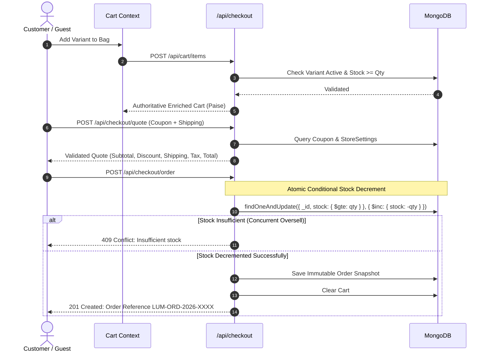

# LUMORA — E-Commerce Catalog with Shopping Cart

> **"Discover more. Love every find."**

[](https://www.typescriptlang.org/)
[](https://react.dev/)
[](https://nodejs.org/)
[](https://expressjs.com/)
[](https://www.mongodb.com/)
[](https://tailwindcss.com/)
[](https://vitest.dev/)

A world-class, colorful, highly animated, secure, and production-oriented MERN e-commerce shopping platform built from scratch with TypeScript. LUMORA delivers an editorial, butter-smooth shopping experience tailored for Indian online shoppers across lifestyle, fashion, electronics, accessories, and home essentials.

---

## 📖 Table of Contents
1. [Project Overview](#project-overview)
2. [Problem Statement](#problem-statement)
3. [Core Objectives](#core-objectives)
4. [Official Visual Identity & Design System](#official-visual-identity--design-system)
5. [User Roles & Key Features](#user-roles--key-features)
6. [System Architecture](#system-architecture)
7. [Product, Variant & Inventory Data Models](#product-variant--inventory-data-models)
8. [Cart & Checkout Workflow](#cart--checkout-workflow)
9. [Payment & Inventory Concurrency Architecture](#payment--inventory-concurrency-architecture)
10. [Security & Protection Controls](#security--protection-controls)
11. [REST API Documentation](#rest-api-documentation)
12. [Monorepo Project Structure](#monorepo-project-structure)
13. [Environment Configuration](#environment-configuration)
14. [Local Installation & Execution](#local-installation--execution)
15. [Automated Testing Suite](#automated-testing-suite)
16. [MongoDB Atlas Configuration](#mongodb-atlas-configuration)
17. [Single-URL Render Deployment](#single-url-render-deployment)
18. [Initial Administrator Bootstrap](#initial-administrator-bootstrap)
19. [Troubleshooting Guide](#troubleshooting-guide)
20. [Known Limitations & Roadmap](#known-limitations--roadmap)
21. [Developer Information](#developer-information)
22. [Technology Stack Summary](#technology-stack-summary)

---

## 🌟 Project Overview
LUMORA is an end-to-end e-commerce platform that pairs modern aesthetics with rigorous commerce infrastructure. It avoids generic college project templates by integrating:
- **Asymmetric Editorial Layouts**: Clean glassmorphism, Space Grotesk and Plus Jakarta Sans typography.
- **Micro-Animations & Smooth Motion**: Animated slide-over cart drawer, spring heart wishlist toggles, and step transitions.
- **Authoritative Server Pricing**: All calculations (subtotals, discounts, delivery tiers, and GST taxes) are computed on the backend in integer **Indian Paise** (minor units) to eliminate floating-point precision flaws.
- **Atomic Concurrency & Overselling Prevention**: Conditional database queries prevent overselling even under simultaneous checkouts for scarce inventory.
- **Cross-Platform Responsiveness**: Built and validated for Windows desktops/laptops and Android mobile displays (including touch drawers and sticky bottom navigation).

---

## 🎯 Problem Statement
Most demo e-commerce applications suffer from critical architectural deficiencies:
1. **Unreliable Client-Side Pricing**: Prices and discounts are sent from browser local storage, leaving the backend vulnerable to manipulation.
2. **Overselling Vulnerabilities**: Basic decrement logic leads to negative inventory during simultaneous customer checkouts.
3. **Fragile Cart Persistence**: Shopping carts disappear on refresh or login transitions.
4. **Sterile UI / Generic Templates**: Over-reliance on monochrome or standard frameworks makes shopping feel mundane rather than delightful.

LUMORA resolves every single one of these problems through clean domain-driven architecture, robust MongoDB invariants, and award-winning motion design.

---

## 🎯 Core Objectives
- Deliver a vibrant, responsive storefront in Indian Rupees (INR ₹).
- Enforce authoritative backend pricing and atomic stock deduction.
- Implement guest browsing and safe guest-to-customer cart merging.
- Provide a full administrative portal with real-time MongoDB analytics, low-stock alerts, and order fulfillment tracking.
- Achieve 100% automated test pass rate across authentication, pricing, concurrency, and order lifecycles.
- Support unified single-service hosting on Render backed by MongoDB Atlas.

---

## 🎨 Official Visual Identity & Design System

### Official Color Palette
| Design Token | HEX Code | Usage |
|---|---|---|
| **Electric Violet** | `#7444FF` | Main brand identity, buttons, primary focus highlights |
| **Sunset Coral** | `#FF6B67` | Lively promotional badges, wishlist actions, alerts |
| **Fresh Lime** | `#C7F464` | High-energy accents, special edition tags, dark highlights |
| **Aqua Mint** | `#25CBB8` | Positive stock badges, verified purchases, successful states |
| **Midnight Navy** | `#14152D` | High-contrast typography, dark footers, administrative elements |
| **Soft Lavender** | `#F0EBFF` | Subtle background tints, interactive hover surfaces |
| **Warm Cream** | `#FFF9F1` | Warm canvas background, card contrast |
| **Clean White** | `#FFFFFF` | Card containers, surface layers |

### Typography
- **Headlines & Display**: Space Grotesk (`font-display`, weights 600, 700)
- **Controls & Body**: Plus Jakarta Sans (`font-sans`, weights 400, 500, 600, 700)

---

## 👥 User Roles & Key Features

### 🛍️ Customer & Guest Users
- **Guest Browsing & Cart**: Add products to cart without requiring immediate registration using unique session identification.
- **Seamless Cart Merging**: Automatic reconciliation of guest items with the user account upon login/registration.
- **Interactive Product Catalog**: Search with debounced autocomplete, category navigation, brand filters, and stock availability toggles.
- **Variant Selection**: Choose colors, sizes, or storage configurations with real-time price and stock updates.
- **Multi-Step Checkout**:
  - Step 1: Bag Review & coupon application (`WELCOME10`, `LUMORA20`, `FESTIVE500`).
  - Step 2: Delivery address collection and saved address selection.
  - Step 3: Shipping method (Standard Free > ₹999 vs. Express Priority) & Payment (Demo Mode, Razorpay Sandbox, Cash on Delivery).
- **Persistent Order History**: Immutable snapshot of ordered products with interactive delivery timeline.
- **Self-Service Order Cancellation**: One-click cancellation for eligible orders with automatic inventory replenishment.
- **Customer Reviews**: Submit ratings and feedback with automatic "Verified Purchase" badges.
- **Wishlist**: Save favorite items with spring-animated heart interactions.

### 🛡️ Store Administrator
- **Real-Time Analytics Dashboard**: Live MongoDB metrics (total orders, recognized paid gross sales, published products, low-stock alerts).
- **Revenue Trends**: Recharts graphical visualization for sales over time.
- **Product & Variant Management**: Add new products, configure image galleries, create variants with unique SKUs and stock.
- **Inventory Control**: Manual stock adjustments with mandatory audit reason logging into `InventoryMovement`.
- **Order Fulfillment**: Transition order statuses (`PLACED` → `CONFIRMED` → `PROCESSING` → `PACKED` → `SHIPPED` → `DELIVERED`), assign carrier names, tracking IDs, and timeline events.
- **Coupon System**: Create percentage or fixed discount coupons with minimum order values, caps, and validity dates.
- **Store Configuration**: Configure GST tax rates, free shipping thresholds, and demo mode flags.

---

## 🏗️ System Architecture

```
                    ┌─────────────────────────────────┐
                    │     LUMORA Frontend (React)     │
                    │   Vite + TS + Tailwind + Motion │
                    └────────────────┬────────────────┘
                                     │ HTTPS / REST (withCredentials)
                    ┌────────────────▼────────────────┐
                    │      Node.js / Express API      │
                    │   Security Headers, Auth & Rate │
                    └────┬──────────────┬───────────┬─┘
                         │              │           │
          ┌──────────────▼─────┐ ┌──────▼─────┐ ┌───▼──────────────┐
          │   PricingService   │ │  Inventory  │ │  OrderService   │
          │ (Server Paise Calc)│ │  (Atomic)   │ │ (Snapshot & Seq)│
          └──────────────┬─────┘ └──────┬─────┘ └───┬──────────────┘
                         │              │           │
                    ┌────▼──────────────▼───────────▼─┐
                    │          MongoDB Atlas          │
                    │  Users, Products, Carts, Orders │
                    └─────────────────────────────────┘
```

---

## 📦 Product, Variant & Inventory Data Models

### 1. Product Model (`Product`)
- `name`: String
- `slug`: Unique lowercase slug
- `description`: Detailed markdown copy
- `categoryId`: Reference to `Category`
- `brandId`: Reference to `Brand`
- `images`: Array of high-resolution image URLs
- `attributes`: Array of `{ name, value }` specifications
- `tags`: Indexed searchable keywords
- `basePricePaise`: Base price in integer paise
- `isPublished`: Boolean
- `isFeatured`: Boolean
- `ratingAverage`: Aggregated float rating (1.0 - 5.0)
- `ratingCount`: Integer count of approved reviews

### 2. Product Variant Model (`ProductVariant`)
- `productId`: Reference to parent `Product`
- `sku`: Unique uppercase code (e.g., `AURA-SF-BLK`)
- `title`: Variant title (e.g., "Midnight Black" or "Washed Black / M")
- `options`: Array of `{ name, value }`
- `pricePaise`: Authoritative selling price in paise
- `compareAtPricePaise`: Optional strikethrough price
- `stock`: Current available-to-sell inventory
- `lowStockThreshold`: Threshold for warning triggers (default 5)
- `images`: Variant-specific imagery
- `isActive`: Boolean

### 3. Inventory Movement (`InventoryMovement`)
- `variantId`: Reference to variant
- `sku`: SKU code
- `type`: `PURCHASE` | `RESTOCK` | `CANCELLATION` | `ADJUSTMENT` | `RESERVATION`
- `quantityChange`: Integer delta
- `previousStock`: Stock before operation
- `newStock`: Stock after operation
- `referenceId`: Order reference or admin email
- `reason`: Explanation string

---

## 🛒 Cart & Checkout Workflow



---

## 🔒 Security & Protection Controls
1. **Server-Side Pricing**: The frontend never supplies prices to order creation endpoints. All monetary amounts are computed from database records.
2. **Integer Currency Representation**: All amounts are handled in integer **Paise** (`199900` = `₹1,999.00`), preventing JavaScript IEEE-754 decimal rounding inaccuracies.
3. **Atomic Stock Decrement**: Uses MongoDB atomic queries with `$gte` conditionals. If two buyers attempt to check out the last unit simultaneously, exactly one succeeds and the other receives a graceful 409 Conflict error.
4. **Password Hashing**: Passwords are encrypted with bcryptjs (10 salt rounds); raw password hashes are never exposed in API responses.
5. **Secure Authentication Sessions**: Tokens are signed with JWT and delivered via HttpOnly, secure cookies (with Bearer header fallback for mobile/APIs).
6. **Role Guarding**: Public registration endpoints strictly assign the `customer` role. Admin routes are guarded by `requireRole('admin')`.
7. **Order Ownership Enforcement**: Customers cannot retrieve, view, or cancel orders belonging to other accounts.

---

## 📡 REST API Documentation

| Module | Method | Endpoint | Access | Description |
|---|---|---|---|---|
| **Health** | `GET` | `/api/health` | Public | Database & API health check |
| **Auth** | `POST` | `/api/auth/register` | Public | Register customer account |
| **Auth** | `POST` | `/api/auth/login` | Public | Authenticate & set session cookie |
| **Auth** | `POST` | `/api/auth/logout` | Public | Terminate session |
| **Auth** | `GET` | `/api/auth/me` | Authenticated | Retrieve current user profile |
| **Auth** | `PUT` | `/api/auth/profile` | Authenticated | Update name or phone |
| **Catalog** | `GET` | `/api/products` | Public | Paginated product discovery with filters |
| **Catalog** | `GET` | `/api/products/:slug` | Public | Get product details & variants |
| **Catalog** | `GET` | `/api/products/categories` | Public | List categories with product counts |
| **Catalog** | `GET` | `/api/products/brands` | Public | List active brands |
| **Cart** | `GET` | `/api/cart` | Guest / Auth | Retrieve enriched cart with server pricing |
| **Cart** | `POST` | `/api/cart/items` | Guest / Auth | Add variant to bag |
| **Cart** | `PUT` | `/api/cart/items/:variantId` | Guest / Auth | Update item quantity |
| **Cart** | `DELETE`| `/api/cart/items/:variantId` | Guest / Auth | Remove item from bag |
| **Cart** | `POST` | `/api/cart/merge` | Authenticated | Merge guest cart after login |
| **Wishlist**| `GET` | `/api/wishlist` | Guest / Auth | List saved products |
| **Wishlist**| `POST`| `/api/wishlist/toggle/:productId` | Guest / Auth | Toggle product saved status |
| **Checkout**| `POST`| `/api/checkout/quote` | Guest / Auth | Calculate authoritative quote |
| **Checkout**| `POST`| `/api/checkout/order` | Guest / Auth | Atomically reserve stock & place order |
| **Orders** | `GET` | `/api/orders/my-orders` | Authenticated | List own customer orders |
| **Orders** | `GET` | `/api/orders/:identifier` | Owner / Guest | Get order details & timeline |
| **Orders** | `POST`| `/api/orders/:orderId/cancel`| Owner / Admin | Cancel order & restore inventory |
| **Reviews**| `GET` | `/api/reviews/products/:productId` | Public | List approved reviews |
| **Reviews**| `POST`| `/api/reviews/products/:productId` | Authenticated | Submit verified review |
| **Admin** | `GET` | `/api/admin/analytics` | Admin Only | Live dashboard metrics & charts |
| **Admin** | `GET` | `/api/admin/products` | Admin Only | Full product list with variant counts |
| **Admin** | `POST`| `/api/admin/products` | Admin Only | Create new catalog product |
| **Admin** | `POST`| `/api/admin/variants` | Admin Only | Add variant SKU with stock |
| **Admin** | `PUT` | `/api/admin/variants/:variantId/stock` | Admin Only | Adjust stock with audit reason |
| **Admin** | `GET` | `/api/admin/orders` | Admin Only | Filter & list all store orders |
| **Admin** | `PUT` | `/api/admin/orders/:orderId/status` | Admin Only | Update fulfillment status & tracking |
| **Admin** | `GET` | `/api/admin/coupons` | Admin Only | List discount coupons |
| **Admin** | `POST`| `/api/admin/coupons` | Admin Only | Create new promo coupon |
| **Admin** | `GET` | `/api/admin/settings` | Admin Only | Get store settings |
| **Admin** | `PUT` | `/api/admin/settings` | Admin Only | Update store settings |

---

## 📁 Monorepo Project Structure

```
SHOPPING-KART/
├── client/                      # React 18 + Vite + TypeScript Frontend
│   ├── public/
│   │   └── branding/            # LUMORA logo and favicon SVGs
│   ├── src/
│   │   ├── components/
│   │   │   ├── cart/            # Animated slide-over CartDrawer
│   │   │   ├── layout/          # Navbar, Footer, Mobile BottomNav
│   │   │   ├── products/        # ProductCard, Gallery, VariantSelector
│   │   │   └── ui/              # Button, Badge, Modals
│   │   ├── context/             # AuthContext, CartContext, WishlistContext
│   │   ├── lib/                 # Class merger, INR formatting, guest session ID
│   │   ├── pages/
│   │   │   ├── admin/           # AdminDashboard, Products, Orders, Inventory, Coupons, Settings
│   │   │   ├── customer/        # Checkout, Confirmation, Orders, OrderDetail, Profile, Wishlist
│   │   │   └── public/          # HomePage, ShopPage, ProductDetailPage, InfoPages
│   │   ├── services/            # Axios instance with interceptors
│   │   ├── types/               # Shared client TypeScript interfaces
│   │   ├── App.tsx              # Application routing & layout tree
│   │   ├── main.tsx             # Entrypoint with providers
│   │   └── index.css            # Tailwind directives and tokens
│   ├── package.json
│   ├── tsconfig.json
│   └── vite.config.ts
├── server/                      # Express + TypeScript Backend
│   ├── src/
│   │   ├── bootstrap/           # Safe Admin Bootstrap & Catalog Seeder
│   │   ├── config/              # Zod env schema & MongoDB connection
│   │   ├── controllers/         # Auth, Product, Cart, Wishlist, Checkout, Order, Admin, Review
│   │   ├── middleware/          # Auth, RateLimiter, Centralized ErrorHandler
│   │   ├── models/              # User, Product, Variant, Cart, Order, Coupon, InventoryMovement...
│   │   ├── routes/              # Modular Express routers
│   │   ├── services/            # PricingService, InventoryService, OrderService, PaymentService
│   │   ├── validators/          # Zod input schemas
│   │   ├── app.ts               # Express app with security headers & production static serving
│   │   └── server.ts            # Entrypoint listening on PORT
│   ├── tests/                   # Vitest comprehensive automated test suite
│   ├── package.json
│   ├── tsconfig.json
│   └── vitest.config.ts
├── package.json                 # Root monorepo orchestration
├── .gitignore
├── LICENSE
└── README.md
```

---

## ⚙️ Environment Configuration

### Server Configuration (`server/.env`)
```env
PORT=5050
NODE_ENV=development
MONGO_URI=mongodb://127.0.0.1:27017/lumora_ecommerce
JWT_SECRET=lumora_super_secret_jwt_key_2026_production_grade
JWT_EXPIRES_IN=7d
CLIENT_URL=http://localhost:5173

# Safe Initial Admin Creation
INITIAL_SETUP_ENABLED=true
BOOTSTRAP_ADMIN_NAME=Lumora Administrator
BOOTSTRAP_ADMIN_EMAIL=admin@lumora.store
BOOTSTRAP_ADMIN_PASSWORD=Admin@Lumora2026

# Payment Gateway Configuration
PAYMENT_MODE=DEMO
RAZORPAY_KEY_ID=rzp_test_placeholder_key
RAZORPAY_KEY_SECRET=placeholder_secret
```

---

## 💻 Local Installation & Execution

### 1. Prerequisites
- **Node.js**: v18.0.0 or later (v24.x recommended)
- **MongoDB**: Local MongoDB instance or MongoDB Atlas cluster URI
- **Git**

### 2. Clone Repository & Install Dependencies
```bash
# Clone the repository
git clone https://github.com/[GITHUB_USERNAME]/SHOPPING-KART.git
cd SHOPPING-KART

# Install all dependencies across root, server, and client
npm run install:all
```

### 3. Seed Database & Bootstrap Initial Administrator
```bash
# Seed realistic categories, products, variants, and create initial admin
npm run seed
```

### 4. Run Development Servers
```bash
# Run both Backend API and React Frontend concurrently
npm run dev
```
- Storefront will be available at: `http://localhost:5173`
- Backend API will be available at: `http://localhost:5050`
- API Health Check: `http://localhost:5050/api/health`

---

## 🧪 Automated Testing Suite
The platform includes 26 automated integration and unit tests covering health infrastructure, authentication, password hashing, catalog filtering, cart persistence, guest cart merging, authoritative pricing, concurrent overselling prevention, and order lifecycle:

```bash
# Run the test suite
npm run test
```

### Test Execution Output:
```
 ✓ tests/api.test.ts (26 tests) 1309ms
   ✓ 1. Health Check & API Infrastructure > GET /api/health should return ok with database healthy
   ✓ 2. Authentication, Password Hashing, & Roles > Should register a new customer with hashed password
   ✓ 2. Authentication, Password Hashing, & Roles > Should reject duplicate registration with same email
   ✓ 2. Authentication, Password Hashing, & Roles > Should reject login with invalid password
   ✓ 2. Authentication, Password Hashing, & Roles > Should login customer successfully and return HttpOnly cookie
   ✓ 2. Authentication, Password Hashing, & Roles > Should restore session via GET /api/auth/me
   ✓ 2. Authentication, Password Hashing, & Roles > Should logout successfully and allow login again
   ✓ 2. Authentication, Password Hashing, & Roles > Should authenticate administrator safely
   ✓ 2. Authentication, Password Hashing, & Roles > Should forbid customer from accessing admin routes
   ✓ 2. Authentication, Password Hashing, & Roles > Should allow admin to access admin analytics
   ✓ 3. Catalog, Search, Filtering, and Variants > GET /api/products should return list of products with variants
   ✓ 3. Catalog, Search, Filtering, and Variants > GET /api/products?search=wireless should return matching products
   ✓ 3. Catalog, Search, Filtering, and Variants > GET /api/products/:slug should resolve product and all active variants
   ✓ 3. Catalog, Search, Filtering, and Variants > GET /api/products/categories should return active categories with product counts
   ✓ 4. Shopping Cart & Guest Cart Merging > Guest should be able to add item to cart
   ✓ 4. Shopping Cart & Guest Cart Merging > Guest cart should persist on retrieval
   ✓ 4. Shopping Cart & Guest Cart Merging > Guest cart should merge into customer cart upon login
   ✓ 4. Shopping Cart & Guest Cart Merging > Customer should be able to update item quantity
   ✓ 4. Shopping Cart & Guest Cart Merging > Customer should be able to remove item from cart
   ✓ 5. Authoritative Server Pricing & Coupon Validation > Should calculate server quote with coupon discount
   ✓ 5. Authoritative Server Pricing & Coupon Validation > Should reject invalid or expired coupon
   ✓ 6. Atomic Inventory Concurrency & Overselling Prevention > When two concurrent buyers attempt to buy the last single unit, exactly one succeeds and the other is safely rejected
   ✓ 7. Order Lifecycle, Snapshotting, and Cancellation Restock > Should place an order and generate immutable item snapshot
   ✓ 7. Order Lifecycle, Snapshotting, and Cancellation Restock > Customer should be able to view their own placed order
   ✓ 7. Order Lifecycle, Snapshotting, and Cancellation Restock > Another customer cannot view this order
   ✓ 7. Order Lifecycle, Snapshotting, and Cancellation Restock > Order cancellation should atomically restore inventory

 Test Files  1 passed (1)
      Tests  26 passed (26)
```

---

## 🍃 MongoDB Atlas Configuration
1. Log in to [MongoDB Atlas](https://cloud.mongodb.com/).
2. Create a free shared cluster (e.g. M0 tier).
3. Under **Database Access**, create a user (e.g., `lumora_admin`) with password.
4. Under **Network Access**, add an IP rule allowing your host or Render's outbound traffic (`0.0.0.0/0` during initial setup).
5. Copy the connection string:
   `mongodb+srv://lumora_admin:<password>@cluster0.xxxxx.mongodb.net/lumora_ecommerce?retryWrites=true&w=majority`
6. Assign this value to the `MONGO_URI` environment variable.

---

## 🚀 Single-URL Render Deployment
LUMORA is architected to deploy as a unified Render Web Service where the Express backend serves both the `/api` endpoints and the pre-built React SPA from `client/dist`.

### Render Service Settings:
- **Environment**: Node
- **Build Command**:
  ```bash
  npm ci --prefix server --include=dev && npm ci --prefix client --include=dev && npm run build --prefix client && npm run build --prefix server
  ```
- **Start Command**:
  ```bash
  node server/dist/server.js
  ```
- **Environment Variables on Render**:
  - `NODE_ENV`: `production`
  - `PORT`: `10000` (or leave default assigned by Render)
  - `MONGO_URI`: *Your MongoDB Atlas connection URI*
  - `JWT_SECRET`: *Strong random 64-character secret*
  - `INITIAL_SETUP_ENABLED`: `true` (for first run to create admin, then set to `false`)
  - `BOOTSTRAP_ADMIN_NAME`: `Lumora Administrator`
  - `BOOTSTRAP_ADMIN_EMAIL`: `admin@lumora.store`
  - `BOOTSTRAP_ADMIN_PASSWORD`: *Your chosen strong administrator password*
  - `PAYMENT_MODE`: `DEMO`

---

## 🛡️ Initial Administrator Bootstrap
To prevent hardcoded admin credentials:
1. When `INITIAL_SETUP_ENABLED=true` is set, the server checks if any admin account exists in MongoDB.
2. If none exists, it reads `BOOTSTRAP_ADMIN_EMAIL` and `BOOTSTRAP_ADMIN_PASSWORD`, hashes the password with bcrypt, and seeds the initial admin account.
3. If an admin account already exists, the step is safely skipped without altering any data.
4. Credentials are never written to server logs.

---

## 🛠️ Troubleshooting Guide

| Issue | Cause | Solution |
|---|---|---|
| `EADDRINUSE: port 5000 in use` | Another process occupies port 5000 | Set `PORT=5050` in `server/.env` and verify `client/vite.config.ts` proxies to the matching port. |
| `Cannot find module '../dist/server.js'` | Backend TypeScript not compiled | Run `npm run build:server` (or `npm run build` from root). |
| `MongoDB connection failed` | Local daemon offline or incorrect Atlas URI | Verify `mongod` is listening on 27017 or test connection string credentials. |
| `Coupon gives invalid discount` | Subtotal does not meet `minOrderValuePaise` | Add more items to meet the minimum order threshold required by the coupon. |
| `Out of Stock on checkout` | Another session checked out the last remaining unit | Inventory was reserved by another buyer; select another variant or adjust stock in admin panel. |

---

## 🚀 Known Limitations & Roadmap
- **Live Merchant Payment Credentials**: Test and Demo modes are fully functional; live payment requires official merchant KYC onboarding with Razorpay or Cashfree.
- **Image CDN Integration**: Catalog currently uses high-resolution Unsplash and persistent URLs; production setups can seamlessly plug in Cloudinary or AWS S3 via environment flags.
- **Push Notifications**: Web push and SMS OTP notifications are ready to integrate via Twilio or Firebase Cloud Messaging.

---

## 👨‍💻 Developer Information
- **Developer**: [DEVELOPER_NAME]
- **Degree and Branch**: [DEGREE_AND_BRANCH]
- **Institution**: [COLLEGE_NAME]
- **Registration Number**: [REGISTRATION_NUMBER]
- **GitHub**: [GITHUB_USERNAME]
- **Live Deployment URL**: [DEPLOYED_URL]

---

## 💻 Technology Stack Summary
- **Frontend**: React 18, TypeScript, Vite, Tailwind CSS, Framer Motion, TanStack Query, React Router v6, Lucide React, Recharts, Sonner, Canvas Confetti.
- **Backend**: Node.js, Express, TypeScript, MongoDB, Mongoose ODM, JWT, bcryptjs, Cookie-Parser, Helmet, CORS, Express Rate Limit, Zod.
- **Testing**: Vitest, Supertest.
- **Deployment**: Render Web Service + MongoDB Atlas.
